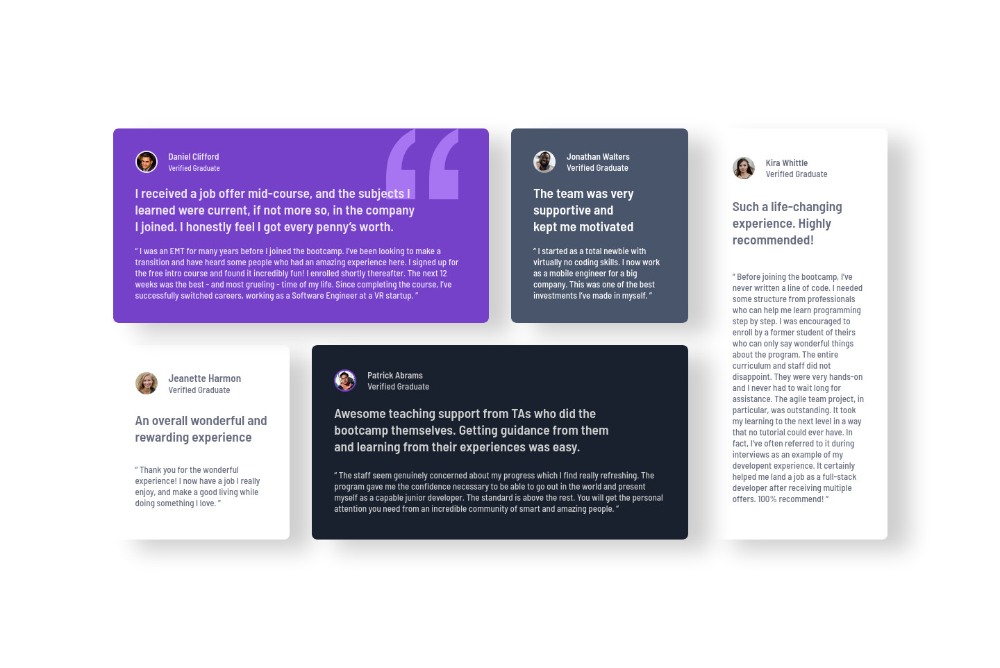

# Frontend Mentor - Testimonials grid section solution

This is a solution to the [Testimonials grid section challenge on Frontend Mentor](https://www.frontendmentor.io/challenges/testimonials-grid-section-Nnw6J7Un7). Frontend Mentor challenges help you improve your coding skills by building realistic projects. 

## Table of contents

- [Overview](#overview)
  - [The challenge](#the-challenge)
  - [Screenshot](#screenshot)
  - [Links](#links)
- [My process](#my-process)
  - [Built with](#built-with)
  - [What I learned](#what-i-learned)
  - [Continued development](#continued-development)
  - [Useful resources](#useful-resources)
- [Author](#author)

## Overview

### The challenge

Users should be able to:

- View the optimal layout for the site depending on their device's screen size

### Screenshot

### Links

- Solution URL: [GitHub](https://github.com/boundothewitch/testimonials-grid-section-main)
- Live Site URL: [Netlify](https://glistening-souffle-05a6dd.netlify.app/)

## My process

### Built with

- Semantic HTML5 markup
- CSS custom properties
- Flexbox
- CSS Grid
- Mobile-first workflow

### What I learned

More extensive use of CSS grids. Mainly using `span` when declaring which area an element stays in.

### Continued development

In the future I plan to use grids more now that I have a better understanding how it works when creating unique layouts.

### Useful resources

[CSS Grid Garden](https://cssgridgarden.com/) - A gameified way to learn how to use CSS grids.

## Author

- Website - [Ash Chapman](https://boundothewitch.github.io)
- Frontend Mentor - [@BoundoTheWitch](https://www.frontendmentor.io/profile/boundothewitch)